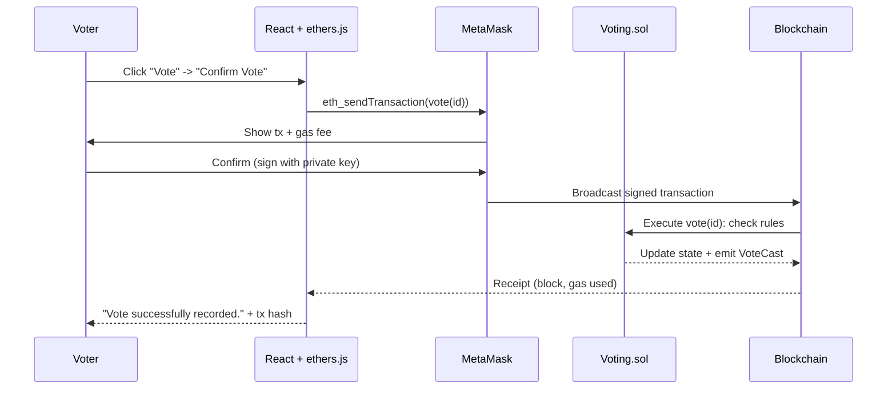
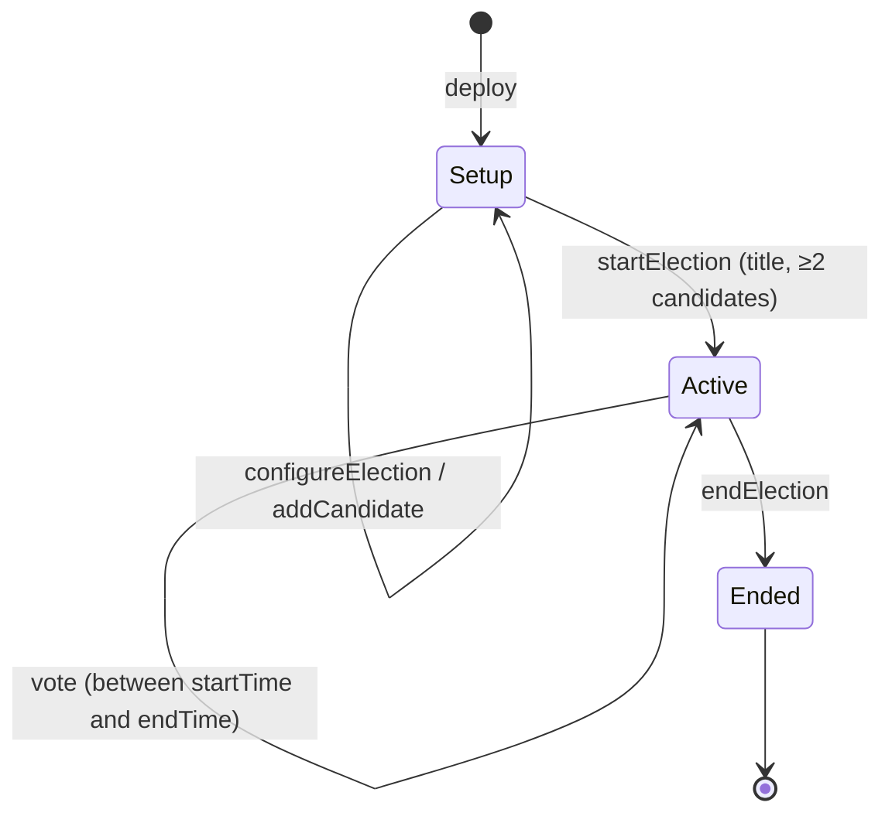

# Decentralized E-Voting System

**BlockVote** is a blockchain-based decentralized application (dApp) for electronic voting, built as a B.Tech Computer Science mini project.

> ⚠️ **Disclaimer:** This project is an educational prototype and is not intended for use in real public elections.
> It runs on a local test blockchain or the Sepolia testnet and uses **test ETH only**, never real money.

| | |
|---|---|
| **Smart contract** | Solidity 0.8.24 (`contracts/Voting.sol`) |
| **Blockchain tooling** | Hardhat 2 (local node, tests, deployment) |
| **Frontend** | React 18 + Vite 5 + Tailwind CSS 3 |
| **Web3** | ethers.js v6 + MetaMask |
| **Charts / icons** | Recharts, Lucide React |
| **Tests** | 33 automated tests, 100% line / 98% branch coverage |

---

## Table of Contents

1. [Introduction](#introduction)
2. [Problem Statement](#problem-statement)
3. [Objectives](#objectives)
4. [Features](#features)
5. [Technology Stack](#technology-stack)
6. [System Architecture](#system-architecture)
7. [Blockchain Architecture](#blockchain-architecture)
8. [Smart Contract](#smart-contract)
9. [User Workflow](#user-workflow)
10. [Admin Workflow](#admin-workflow)
11. [Voting Workflow](#voting-workflow)
12. [Installation](#installation)
13. [Configuration](#configuration)
14. [Running Local Blockchain](#running-local-blockchain)
15. [Deploying Smart Contract](#deploying-smart-contract)
16. [Running Frontend](#running-frontend)
17. [Testing](#testing)
18. [MetaMask Setup](#metamask-setup)
19. [Demo Procedure](#demo-procedure)
20. [Screenshots Placeholder](#screenshots-placeholder)
21. [Limitations](#limitations)
22. [Future Scope](#future-scope)
23. [Security Considerations](#security-considerations)
24. [Troubleshooting](#troubleshooting)
25. [Viva Questions](#viva-questions)

---

## Introduction

Traditional electronic voting systems store votes in a central database controlled by one organisation. Voters must trust that the operator does not change, delete or miscount votes.

This project replaces the central database with a **smart contract on an Ethereum-compatible blockchain**. The election rules (who can vote, when, and how many times) are written in Solidity code. Every vote is a **signed blockchain transaction**, permanently recorded in a block and publicly verifiable. A React web interface lets administrators manage the election and voters cast their vote through **MetaMask**.

## Problem Statement

Centralised e-voting systems suffer from:

- **Single point of control:** the database administrator could alter results.
- **Lack of transparency:** voters cannot independently verify the tally.
- **Weak audit trail:** logs can be edited or deleted.
- **Double voting risks:** depend entirely on correct server-side checks.

The goal is to demonstrate how a decentralized application can provide a transparent, tamper-resistant and auditable voting process in an **educational** scenario.

## Objectives

1. Implement election logic (candidates, voting window, one vote per wallet) in a Solidity smart contract.
2. Allow only the administrator (contract owner) to create and manage the election.
3. Let voters authenticate with a MetaMask wallet and cast exactly one vote.
4. Record every action as a blockchain transaction and event to create a public audit trail.
5. Display live and final results with charts, the winner and vote percentages.
6. Verify the contract with automated tests.
7. Clearly explain the limitations of blockchain voting.

## Features

**Administrator**
- Recognised automatically as the contract owner when connecting MetaMask
- Set election title, description, start time and end time
- Add candidates (name and description), only before the election starts
- Start and end the election (with confirmation dialogs)
- View candidate table (ID, name, votes), total votes, status and life-cycle stepper
- Live blockchain transaction status (awaiting signature, pending, confirmed with block, gas and fee, or failed)

**Voter**
- Connect MetaMask, see wallet address, balance, network and role
- View election details, live status badge and countdown
- View candidate cards with avatar, ID, description and live vote count
- Confirmation modal, then "Confirm this transaction in MetaMask", then success screen with **transaction hash, block number, gas used and fee**
- "Already Voted" status, plus the candidate this wallet voted for
- **Double-vote demonstration:** a button that sends a second vote directly to the contract to show it gets rejected
- **Access-control demonstration:** non-admins can try an admin action and see the contract reject it

**Results and transparency**
- Total votes, winner (verified through the contract's `getWinner()`), tie detection
- Horizontal bar chart (ranking) and donut chart (vote share)
- Ranking table with percentages
- **Blockchain activity feed** rebuilt from contract events (`VoteCast`, `CandidateAdded`, and others)

**UI/UX**
- Dark and light themes, glassmorphism cards, gradients, animations
- Fully responsive (tested at 390 px phone width)
- Toast notifications, loading skeletons, confirmation dialogs
- Clear messages for every failure (see [Error handling](#error-handling))

## Technology Stack

| Layer | Technology | Purpose |
|---|---|---|
| Smart contract | **Solidity ^0.8.24** | Election and voting logic |
| Development framework | **Hardhat 2** + Hardhat Toolbox | Compile, test, run local chain, deploy |
| Blockchain | Hardhat local network (chain 31337) / **Sepolia** testnet (11155111) | Ethereum-compatible ledger |
| Web3 library | **ethers.js v6** | Read contract state, send transactions |
| Wallet | **MetaMask** | Key management, signing, network switching |
| Frontend | **React 18 + Vite 5** | Single-page application |
| Styling | **Tailwind CSS 3** | Responsive glassmorphism UI |
| Charts | **Recharts** | Bar and donut charts |
| Icons / toasts | Lucide React, react-hot-toast | UI feedback |
| Testing | Mocha + Chai + Hardhat network helpers | Contract unit tests, coverage |

There is **no backend server and no database**: the blockchain is the single source of truth.

## System Architecture

```
                    +----------------------+
                    |      USER            |
                    |  Voter / Admin       |
                    +----------+-----------+
                               |
                               v
                    +----------------------+
                    |   React Frontend     |
                    |      Vite            |
                    +----------+-----------+
                               |
                               v
                    +----------------------+
                    |      ethers.js       |
                    |  Web3 Interaction    |
                    +----------+-----------+
                               |
                               v
                    +----------------------+
                    |      MetaMask        |
                    |   Wallet Provider    |
                    +----------+-----------+
                               |
                               v
                    +----------------------+
                    | Solidity Smart       |
                    | Contract (Voting.sol)|
                    |                      |
                    | Election Logic       |
                    | Voting Logic         |
                    | Candidate Data       |
                    | Voter Status         |
                    +----------+-----------+
                               |
                               v
                    +----------------------+
                    | Ethereum-Compatible  |
                    | Blockchain           |
                    +----------------------+
```

**Reads vs writes**

- **Reads** (election details, candidates, `hasVoted`, events) are free `view` calls sent through a JSON-RPC provider. No wallet is needed, so anyone can audit the election.
- **Writes** (vote, add candidate, start or end) are transactions. ethers.js builds them, **MetaMask signs them** with the user's private key, and the network executes the contract and records them in a block.



## Blockchain Architecture

- **Network:** Ethereum-compatible. Locally, `npx hardhat node` runs a single-node chain with 20 pre-funded test accounts (10,000 test ETH each). On Sepolia, the contract runs on a public proof-of-stake test network.
- **Accounts:** externally owned accounts (wallets) identified by 20-byte addresses. The account that deploys the contract becomes the **owner/admin**.
- **Transactions:** every state change is a signed transaction that costs gas. Measured on the local network:

  | Operation | Gas used |
  |---|---|
  | Deploy `Voting` | ~1,550,000 |
  | `configureElection` | ~209,000 |
  | `addCandidate` | ~149,000 |
  | `startElection` | ~56,000 |
  | `vote` | ~64,000 |

- **Events (logs):** `ElectionConfigured`, `CandidateAdded`, `ElectionStarted`, `ElectionEnded`, `VoteCast(voter, candidateId)`. These are cheap, permanent and searchable. The frontend's activity feed is rebuilt entirely from them.
- **Immutability:** once a block is confirmed, its transactions cannot be changed without rewriting every later block, which the network's consensus rejects.

## Smart Contract

File: [`contracts/Voting.sol`](contracts/Voting.sol). One deployed contract is one election.

### State

```solidity
address public owner;                  // administrator (deployer)
string  public electionTitle;
string  public electionDescription;
uint256 public startTime;              // unix seconds
uint256 public endTime;                // unix seconds
Phase   public phase;                  // Setup -> Active -> Ended
Candidate[] private candidates;        // struct { id, name, description, voteCount }
mapping(address => bool) public hasVoted;
uint256 public totalVotes;
```

### Functions

| Function | Access | Description |
|---|---|---|
| `constructor()` | deployer | Sets `owner = msg.sender`, phase = Setup |
| `configureElection(title, description, start, end)` | onlyOwner, Setup | Set or update election details |
| `addCandidate(name, description)` | onlyOwner, Setup | Register a candidate (ID = index) |
| `startElection()` | onlyOwner, Setup | Needs title, ≥ 2 candidates, end time in the future |
| `endElection()` | onlyOwner, Active | Close voting; results become final |
| `vote(candidateId)` | anyone | One vote per wallet inside the voting window |
| `getCandidates()` / `getCandidate(id)` / `getCandidateCount()` | view | Candidate data |
| `getResults()` | view | All candidates plus total votes |
| `getWinner()` | view | Winner, votes and tie flag (only after the election ends or the time is over) |
| `getTotalVotes()`, `hasUserVoted(addr)`, `isVotingOpen()` | view | Status helpers |
| `getElectionStatus()` | view | Human readable: Not Started / Scheduled / Voting Open / Voting Period Over / Ended |
| `getElectionDetails()` | view | Everything the dashboard needs in one call |

### Vote validation (in order)

```solidity
function vote(uint256 candidateId) external {
    if (phase != Phase.Active)                 revert ElectionNotActive();
    if (block.timestamp < startTime)           revert VotingNotStarted();
    if (block.timestamp > endTime)             revert VotingPeriodOver();
    if (hasVoted[msg.sender])                  revert AlreadyVoted();
    if (candidateId >= candidates.length)      revert InvalidCandidate(candidateId);

    hasVoted[msg.sender] = true;               // mark the voter first
    candidates[candidateId].voteCount++;
    totalVotes++;
    emit VoteCast(msg.sender, candidateId);
}
```

The contract uses **custom errors** (cheaper than revert strings). The frontend decodes them into friendly messages, for example `AlreadyVoted()` becomes *"This wallet has already voted. The smart contract allows only one vote per wallet."*

## User Workflow

1. Open the app. Election data loads directly from the blockchain (no wallet needed to view).
2. Click **Connect Wallet**. MetaMask asks for permission (`eth_requestAccounts`).
3. The navbar shows the short address (e.g. `0x7099...79C8`). If MetaMask is on the wrong network, a **Switch network** button appears.
4. Open **Election** for the dashboard (status, countdown, totals, your voter status, activity feed).
5. Open **Candidates** to vote, and **Results** for charts and the winner.

## Admin Workflow

1. Deploy the contract. The deploying account is the admin.
2. Connect the admin account in MetaMask and open **Admin**.
3. **Election Management:** fill in name, description, start and end, then click **Save Election Details** (transaction).
4. **Candidate Management:** add each candidate (one transaction each).
5. Click **Start Election** and confirm. The details and candidate list are now locked on-chain.
6. Monitor votes in the stats cards and candidate table.
7. Click **End Election** to close voting. Results become final.



## Voting Workflow

1. Voter clicks **Vote** on a candidate card.
2. Modal: *"Are you sure you want to vote for Rahul Sharma?"* with **[Cancel] [Confirm Vote]**.
3. *"Confirm this transaction in MetaMask."* MetaMask shows the gas fee.
4. After signing: *"Recording your vote on the blockchain..."* with the transaction hash.
5. When mined: *"Vote successfully recorded."* with hash, block number, gas used and fee.
6. The wallet is now shown as **Already Voted**, and the chosen card is marked **Your vote**.
7. Any further vote from this wallet is rejected by the smart contract.

## Installation

**Prerequisites**

- [Node.js](https://nodejs.org/) 18 or newer (tested with Node 22) and npm
- [MetaMask](https://metamask.io/download/) browser extension (Chrome, Edge, Brave or Firefox)
- Internet access the first time you compile (Hardhat downloads the Solidity compiler)

```bash
# 1. Install blockchain dependencies (project root)
npm install

# 2. Install frontend dependencies
cd frontend
npm install
cd ..
```

## Configuration

For **local development no configuration is needed.** `scripts/deploy.js` automatically writes the contract **address, chain ID, deployment block and ABI** to `frontend/src/contracts/Voting.json`, and the frontend reads it from there.

Optional: copy `.env.example` to `.env` in the project root to override values:

| Variable | Used by | Meaning |
|---|---|---|
| `VITE_CONTRACT_ADDRESS` | frontend | Contract address (overrides `Voting.json`) |
| `VITE_CHAIN_ID` | frontend | `31337` (local) or `11155111` (Sepolia) |
| `VITE_RPC_URL` | frontend | RPC used to read data (default `http://127.0.0.1:8545` locally) |
| `SEPOLIA_RPC_URL` | Hardhat | Sepolia RPC endpoint (only for Sepolia deployment) |
| `PRIVATE_KEY` | Hardhat | Private key of a **test-only** wallet (only for Sepolia) |
| `ETHERSCAN_API_KEY` | Hardhat | Optional, for contract verification |

> 🔒 `.env` is listed in `.gitignore`. Never commit private keys. Only variables starting with `VITE_` are exposed to the browser.

> If you set `VITE_CONTRACT_ADDRESS`, remember to update it after every redeploy (or leave it empty to use `Voting.json` automatically).

## Running Local Blockchain

Open **terminal 1** and keep it running:

```bash
npx hardhat node
```

This starts a JSON-RPC server at `http://127.0.0.1:8545` (chain ID **31337**) and prints 20 test accounts with their private keys. These are public, well-known keys: **never use them on a real network.**

> Restarting `npx hardhat node` wipes the chain. You must redeploy afterwards and reset MetaMask's activity (see [Troubleshooting](#troubleshooting)).

## Deploying Smart Contract

Open **terminal 2** in the project root:

```bash
# Compile
npx hardhat compile

# Deploy + create the demo election + cast 6 sample votes (recommended for the demo)
npm run demo:local
```

`demo:local` runs three scripts:

| Command | Script | What it does |
|---|---|---|
| `npm run deploy:local` | `scripts/deploy.js` | Deploys `Voting.sol` and writes `frontend/src/contracts/Voting.json` |
| `npm run seed:local` | `scripts/seed-demo.js` | Creates *"Student Council Election 2026"* (7 days) with Alice Johnson, Rahul Sharma, Priya Nair, Arjun Mehta, and starts it |
| `npm run votes:local` | `scripts/cast-sample-votes.js` | Casts 6 votes from test accounts #10–#15 (Alice 2, Rahul 2, Priya 1, Arjun 1) |

To demonstrate the **admin workflow from scratch** instead, run only `npm run deploy:local` and set up the election in the Admin page.

### Optional: Sepolia testnet

1. Create a **new test-only** MetaMask account and get free Sepolia ETH from a faucet (e.g. Google Cloud Web3 faucet, Alchemy or Infura faucet).
2. Get a Sepolia RPC URL (Alchemy, Infura, or `https://ethereum-sepolia-rpc.publicnode.com`).
3. Create `.env`:
   ```env
   SEPOLIA_RPC_URL=https://ethereum-sepolia-rpc.publicnode.com
   PRIVATE_KEY=<test wallet private key>
   VITE_CHAIN_ID=11155111
   VITE_RPC_URL=https://ethereum-sepolia-rpc.publicnode.com
   ```
4. Deploy and (optionally) create the demo election:
   ```bash
   npm run deploy:sepolia
   npm run seed:sepolia
   ```
5. Optional verification on Etherscan: `npx hardhat verify --network sepolia <CONTRACT_ADDRESS>`
6. Start the frontend. Transaction hashes now link to `sepolia.etherscan.io`.

## Running Frontend

Open **terminal 3**:

```bash
cd frontend
npm run dev
```

Open **http://localhost:5173**. For a production build: `npm run build` (output in `frontend/dist`).

## Testing

```bash
npx hardhat test        # 33 tests
npx hardhat coverage    # coverage report (coverage/index.html)
REPORT_GAS=true npx hardhat test   # optional gas report (Linux/macOS syntax)
```

Coverage of `Voting.sol`: **100% statements, 100% functions, 100% lines, 98.4% branches.**

| # | Requirement | Test(s) |
|---|---|---|
| 1 | Contract deployment | `deploys with a valid address` |
| 2 | Owner assignment | `sets the deployer as owner` |
| 3 | Candidate creation | `adds candidates with sequential IDs...`, `rejects an empty candidate name` |
| 4 | Election creation | `stores title, description and times...`, time-range and empty-title checks |
| 5 | Election start | `starts the election...`, needs title, ≥ 2 candidates, future end, not twice |
| 6 | Election end | `ends the election...`, `cannot end an election that has not started` |
| 7 | Valid vote | `accepts a valid vote, updates counts and emits VoteCast` |
| 8 | Duplicate vote rejection | `rejects a second vote from the same wallet` |
| 9 | Invalid candidate rejection | `rejects an invalid candidate ID` |
| 10 | Voting before election | `rejects voting while... in setup`, `rejects voting before the start time` |
| 11 | Voting after election | `rejects voting after the end time`, `...after the admin ended the election` |
| 12 | Unauthorized admin operation | `blocks non-owners from every admin function` |
| 13 | Vote count update | `counts votes from multiple wallets correctly` |
| 14 | Winner / results | winner, tie, tie cleared, `ResultsNotFinal` before the end, auto-final after end time |

The full frontend flow (connect, vote, double-vote rejection, non-admin rejection, admin setup, start, end, results, mobile layout) was also verified in a real browser against a local Hardhat node.

## MetaMask Setup

### 1. Add the Hardhat network

MetaMask → network selector → **Add network** → **Add a network manually**:

| Field | Value |
|---|---|
| Network name | `Hardhat Localhost` |
| New RPC URL | `http://127.0.0.1:8545` |
| Chain ID | `31337` |
| Currency symbol | `ETH` |
| Block explorer | *(leave empty)* |

(The dApp can also add or switch the network for you via the **Switch network** button.)

### 2. Import test accounts

MetaMask → account menu → **Add account or hardware wallet** → **Import account** → paste a private key printed by `npx hardhat node`:

| Role in demo | Hardhat account | Address |
|---|---|---|
| **Admin** (deployer) | #0 | `0xf39Fd6e51aad88F6F4ce6aB8827279cffFb92266` |
| **Voter 1** | #1 | `0x70997970C51812dc3A010C7d01b50e0d17dc79C8` |
| **Voter 2** | #2 | `0x3C44CdDdB6a900fa2b585dd299e03d12FA4293BC` |

The private keys are printed in terminal 1. They are public Hardhat defaults and must only be used for local testing.

### 3. Connect

Select the imported account in MetaMask, click **Connect Wallet** in the dApp and approve. Switch accounts inside MetaMask at any time; the app updates automatically.

## Demo Procedure

Prepare: terminal 1 `npx hardhat node`, terminal 2 `npm run demo:local`, terminal 3 `cd frontend && npm run dev`; MetaMask on *Hardhat Localhost* with accounts #0 and #1 imported.

| Step | Action | What to point out |
|---|---|---|
| 1 | Open `http://localhost:5173` | Landing page, live data read from the chain without a wallet |
| 2 | Click **Connect Wallet** with **Voter 1** | MetaMask permission popup (`eth_requestAccounts`) |
| 3 | Show the navbar address `0x7099...79C8` and the dropdown | Wallet = identity; balance; role "Voter" |
| 4 | **Election** page | Status *Voting Open*, countdown, 4 candidates, 6 votes, activity feed of events |
| 5 | **Candidates** page | Candidate cards, IDs, descriptions, live counts |
| 6 | Click **Vote** on *Rahul Sharma* | Confirmation modal |
| 7 | **Confirm Vote** | "Confirm this transaction in MetaMask." |
| 8 | MetaMask popup | Gas fee, contract interaction |
| 9 | Confirm in MetaMask | Transaction is broadcast and mined |
| 10 | Success screen | Tx hash, block number, gas used, fee |
| 11 | Card shows **Your vote**, banner **Already Voted** | `hasVoted[msg.sender] = true` on-chain |
| 12 | Click **Try to vote again** | Contract rejects: *"This wallet has already voted..."* |
| 13 | Switch MetaMask to **Admin (#0)** | Navbar shows a crown; Admin page unlocks |
| 14 | Admin → **End Election** → confirm → MetaMask | Status becomes *Election Ended* |
| 15 | **Results** page | Final results, bar and donut charts, ranking table |
| 16 | Winner card | 🏆 **Rahul Sharma**, 3 votes, 42.9%, verified by `getWinner()` |

Bonus: with Voter 1 selected, open **Admin** and click **Try to end the election** to show `NotOwner()` access control.

## Screenshots Placeholder

Add your screenshots to `docs/screenshots/` and reference them here:

| Screen | File |
|---|---|
| Landing page | `docs/screenshots/01-home.png` |
| Election dashboard | `docs/screenshots/02-election.png` |
| Candidates / ballot | `docs/screenshots/03-candidates.png` |
| Vote confirmation modal | `docs/screenshots/04-confirm-vote.png` |
| MetaMask transaction popup | `docs/screenshots/05-metamask.png` |
| Vote success with tx hash | `docs/screenshots/06-vote-success.png` |
| Double vote rejected | `docs/screenshots/07-double-vote.png` |
| Admin dashboard | `docs/screenshots/08-admin.png` |
| Results and winner | `docs/screenshots/09-results.png` |
| Mobile view | `docs/screenshots/10-mobile.png` |

## Limitations

- **Not for real elections.** This is an academic demonstration.
- **No real-world identity verification.** Blockchain only proves that a transaction was signed by a private key. It does not prove the signer is an eligible, unique human. One person can create many wallets (a *Sybil attack*). There is no voter registration list in this prototype: any wallet can vote once.
- **No ballot secrecy.** Wallet addresses are *pseudonymous*, not anonymous. *Because transactions on a public blockchain can be inspected, this educational prototype should not be considered a privacy-preserving election system.* Anyone can see which address voted for which candidate.
- **Live tallies are public** during the election, which could influence later voters.
- **Gas fees and wallets** make participation harder for non-technical users.
- **Admin trust:** the admin chooses the voting window and can end the election early (all actions are publicly logged).
- **Coercion and vote-buying** are not addressed (a voter can prove how they voted).
- **Frontend hosting** is centralised (although the contract rules cannot be bypassed by changing the frontend).

## Future Scope

- **Voter eligibility:** an admin-managed whitelist, Merkle-tree allowlists, or **Decentralized Identity (DID)** / verifiable credentials issued by the institution.
- **Privacy:** **commit-reveal voting**, **zero-knowledge proofs** (e.g. Semaphore / MACI), **homomorphic encryption** for encrypted tallies, **anonymous credentials**.
- **Multiple elections** in one contract (factory pattern) and election history.
- **Gasless voting** using meta-transactions (EIP-2771) or account abstraction (ERC-4337), so voters do not need ETH.
- **Layer-2 deployment** (Polygon, Arbitrum, Optimism) for lower fees.
- **Decentralized frontend hosting** on IPFS.
- Accessibility improvements, multi-language support, mobile wallet support (WalletConnect).
- Independent security audit and formal verification.

## Security Considerations

Implemented in the contract:

- ✅ `onlyOwner` modifier on all administrative functions (`NotOwner()` error)
- ✅ Double voting prevented by `mapping(address => bool) hasVoted`
- ✅ Candidate ID validation (`InvalidCandidate`)
- ✅ Voting allowed only in phase `Active` **and** between `startTime` and `endTime`
- ✅ Candidates and election details locked after start (`InvalidPhase`)
- ✅ Election needs a title, ≥ 2 candidates and a future end time to start
- ✅ Solidity 0.8 built-in overflow and underflow checks
- ✅ Custom errors with meaningful names
- ✅ Uses `msg.sender`, **never `tx.origin`**
- ✅ State updated before emitting events; no external calls, no Ether handling, so no re-entrancy surface
- ✅ **No sensitive personal data on-chain.** Only wallet addresses and candidate names and descriptions. Never store passwords, private keys, Aadhaar numbers, phone numbers or other personal data on a blockchain: **all blockchain data is public and permanent.**

In the frontend and tooling:

- Private keys stay inside MetaMask. The app never sees them.
- `.env` (for Sepolia deployment) is git-ignored; only `VITE_*` values reach the browser.
- Hiding buttons is not security: every rule is enforced by the contract, and the UI includes buttons to demonstrate this.

### Error handling

| Situation | Message shown |
|---|---|
| MetaMask not installed | "MetaMask is not installed. Please install MetaMask to continue." (+ install link) |
| User rejects connection | "Wallet connection request was rejected." |
| Wrong network | "Please switch to the Hardhat Localhost network." (+ one-click switch) |
| Transaction rejected | "Transaction rejected by user." |
| Insufficient gas | "Insufficient funds to pay the gas fee. Use a funded test account (test ETH only)." |
| Contract not deployed | Banner: "Contract unavailable on this network" with redeploy instructions |
| RPC failure | Banner: "Cannot reach the blockchain" with retry |
| Pending / failed transaction | Toast + status list (awaiting signature, pending, confirmed or failed) |
| Duplicate vote | "This wallet has already voted. The smart contract allows only one vote per wallet." |
| Election closed | "The voting period is over..." / "The election is not active..." |
| Invalid candidate | "Invalid candidate (ID n)." |
| Non-admin action | "Only the election administrator can perform this action..." |
| Restarted node (nonce mismatch) | Explains how to clear MetaMask activity data |

## Troubleshooting

| Problem | Fix |
|---|---|
| `HH502` / `HH501` couldn't download compiler | Temporary network issue. Run `npx hardhat compile` again. |
| Banner "Contract unavailable on this network" | The node was restarted. Run `npm run demo:local` again. |
| MetaMask: *nonce too high* / transactions stuck | MetaMask → Settings → Advanced → **Clear activity tab data** (needed after every node restart). |
| MetaMask shows wrong balance or old data | Switch networks away and back, or clear activity tab data. |
| "Cannot reach the blockchain" | Make sure `npx hardhat node` is running in terminal 1. |
| Admin page says "Administrator access only" | Select Hardhat account **#0** (the deployer) in MetaMask. |
| Voting not open | Seed script sets a 7-day window. If you created the election manually, check start and end times. |

## Project Structure

```
Blockchain e-Voting/
├── contracts/
│   └── Voting.sol                 # Smart contract
├── scripts/
│   ├── deploy.js                  # Deploy + export ABI/address to frontend
│   ├── seed-demo.js               # Create & start demo election
│   ├── cast-sample-votes.js       # Sample votes (local only)
│   └── utils.js
├── test/
│   └── Voting.test.js             # 33 Hardhat tests
├── frontend/
│   ├── src/
│   │   ├── components/            # Navbar, WalletConnect, CandidateCard, ElectionStats,
│   │   │                          # VotingModal, ResultsChart, ActivityFeed, VoterStatus,
│   │   │                          # TransactionList, ConfirmDialog, Modal, NetworkBanner, Footer, ui
│   │   ├── context/               # Web3Context (wallet + contract state), ThemeContext
│   │   ├── pages/                 # Home, Election, Candidates, Results, Admin, About
│   │   ├── contracts/Voting.json  # ABI + address (generated by deploy.js)
│   │   ├── utils/                 # blockchain.js (ethers.js helpers, error decoding), useNow.js
│   │   ├── App.jsx, main.jsx, index.css
│   ├── index.html, package.json, vite.config.js, tailwind.config.js
├── docs/                          # College report chapters 01–15
├── hardhat.config.js
├── package.json
├── .env.example
├── .gitignore
└── README.md
```

## Viva Questions

<details>
<summary><b>Click to expand 25 viva questions with answers</b></summary>

**1. What is blockchain?**
A blockchain is a distributed, append-only ledger. Data is grouped into blocks; each block contains the cryptographic hash of the previous block, forming a chain. Many nodes keep a copy and agree on new blocks through a consensus mechanism, so no single party controls it.

**2. Why use blockchain for voting?**
To make the voting record transparent (anyone can verify the tally), tamper-resistant (confirmed votes cannot be altered), and free from a single controlling authority. The voting rules are enforced automatically by a smart contract.

**3. What is a dApp?**
A decentralized application: a frontend (here React) whose backend logic runs as smart contracts on a blockchain instead of on a central server.

**4. What is a smart contract?**
A program stored on the blockchain that runs exactly as written when called by a transaction. Its code and state are public, and its results are agreed by all nodes. Our `Voting.sol` holds the election rules.

**5. Why Solidity?**
Solidity is the most widely used language for the Ethereum Virtual Machine (EVM). It is statically typed, has good tooling (Hardhat, OpenZeppelin) and, since version 0.8, built-in overflow checks.

**6. What is Ethereum?**
A public, programmable blockchain that runs smart contracts on the EVM. Its currency, Ether (ETH), pays for gas. We use Ethereum-compatible networks: the Hardhat local network and the Sepolia testnet.

**7. What is MetaMask?**
A browser wallet that stores the user's private keys, connects websites to the blockchain (EIP-1193 provider `window.ethereum`) and asks the user to approve and sign each transaction.

**8. What is a wallet address?**
A 20-byte identifier (e.g. `0x7099...79C8`) derived from the public key of a key pair. Whoever holds the matching private key controls the address.

**9. What is gas?**
The unit of computational work on Ethereum. Every transaction pays `gas used × gas price` in ETH to validators. It prevents spam and infinite loops. A vote in our contract uses about 64,000 gas; on our test networks it is paid with free test ETH.

**10. What happens when a user votes?**
The UI calls `vote(candidateId)` through ethers.js. MetaMask shows the transaction, and the user signs it. The signed transaction is broadcast; a node executes the contract, which checks the phase, time window, `hasVoted` and candidate ID. Then it sets `hasVoted[msg.sender] = true`, increments the count and emits `VoteCast`. The transaction is included in a block and the UI shows the hash and receipt.

**11. How do you prevent double voting?**
`mapping(address => bool) public hasVoted`. The contract reverts with `AlreadyVoted()` if `hasVoted[msg.sender]` is already true. This check runs on-chain, so it cannot be bypassed from the frontend.

**12. How does the smart contract know the voter?**
Through `msg.sender`: the address that signed the transaction. Signatures cannot be forged without the private key. We never use `tx.origin`.

**13. What is immutability?**
Once data is in a confirmed block it cannot be changed: altering it would change the block's hash and break every later block, and honest nodes would reject it.

**14. What is decentralization?**
Control and data are spread across many independent nodes instead of one server or organisation. There is no single point of failure or control.

**15. What are blockchain transactions?**
Signed messages from an account that transfer value or call a contract function, changing the blockchain state. Each has a unique hash, a sender, a gas fee and, once mined, a block number and receipt.

**16. What are blockchain events?**
Logs emitted by smart contracts (e.g. `VoteCast(voter, candidateId)`) and stored in transaction receipts. They are cheap, permanent and searchable. Our activity feed is built from them.

**17. Why are votes transparent?**
All contract state and events are public. Anyone can call `getResults()` or read `VoteCast` events to independently recount the votes.

**18. What are the limitations?**
No real-world identity check (one person can own many wallets), no ballot secrecy, gas fees, need for a wallet, public live tallies, and trust in the admin's settings. See [Limitations](#limitations).

**19. Is the system anonymous?**
No. It is *pseudonymous*: votes are linked to wallet addresses, not names, but anyone can see which address voted for whom, and addresses can often be linked to people.

**20. Can this system be used for government elections?**
No. It lacks voter identity verification, ballot secrecy, coercion resistance, accessibility, legal compliance and independent audits. It is an educational prototype.

**21. What happens if MetaMask rejects a transaction?**
Nothing is sent to the blockchain. ethers.js throws an `ACTION_REJECTED` error, the UI shows "Transaction rejected by user.", and no state or vote changes.

**22. What happens if the user tries to vote twice?**
The contract reverts with `AlreadyVoted()`. MetaMask or ethers detects the revert during gas estimation, and the UI shows "This wallet has already voted...". The vote count does not change. The **Try to vote again** button demonstrates this live.

**23. What happens if someone changes the frontend?**
They could change what *their* browser shows, but not the rules. Every transaction is validated by the smart contract on-chain, so a modified frontend still cannot vote twice, vote outside the window or perform admin actions. The **Try to end the election** button on the Admin page demonstrates this.

**24. Why is blockchain better than a normal database for this demonstration?**
A database admin can silently edit rows; on a blockchain, past transactions are immutable and public, the rules are enforced by code everyone can read, and there is a complete audit trail of events, without trusting a single operator.

**25. What improvements would be required for a real-world voting system?**
Verified voter identity and eligibility (DID or government credentials), secret ballots (ZK proofs, homomorphic encryption, MACI), coercion resistance, gasless and accessible UX, scalable networks, formal verification, independent audits, legal compliance, and recovery procedures.

</details>

More detailed answers, a 2-minute speech and a 5-minute demo script are in [`docs/15-viva-and-presentation.md`](docs/15-viva-and-presentation.md).

---

## License

MIT, for educational use.

> **This project is an educational prototype and is not intended for use in real public elections.**
