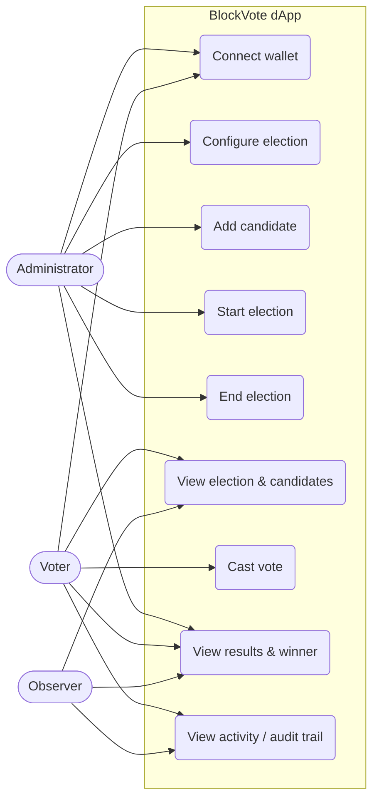
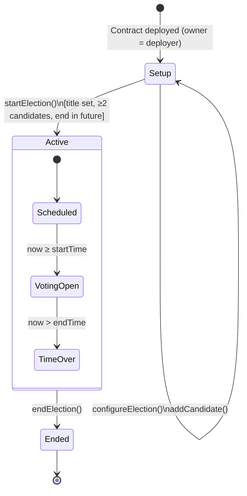
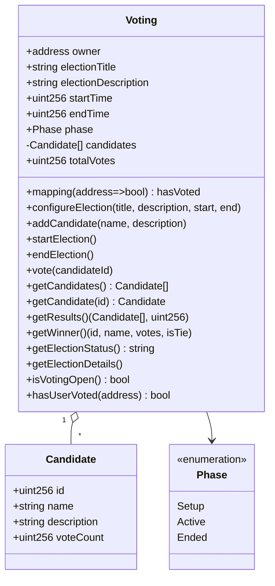

# Chapter 6: System Design

## 6.1 Use case diagram

## 6.2 Election life-cycle (state diagram)

The on-chain `Phase` enum has three values (Setup, Active, Ended). The sub-states *Scheduled*, *Voting Open* and *Voting Period Over* are derived from `block.timestamp`, and `getElectionStatus()` returns them as text.

## 6.3 Data design (smart contract storage)

Because the blockchain is the database, the "schema" is the contract's state variables.

**Design decisions**

- **Candidate ID = array index**, so validation is just `candidateId < candidates.length`.
- **`hasVoted` mapping** gives O(1) lookup with constant gas, independent of the number of voters.
- **`totalVotes` counter** avoids looping over candidates to sum votes.
- **No personal data stored**: only addresses and candidate names and descriptions, because all on-chain data is public forever.
- **One contract per election** keeps the logic simple; a new election means a new deployment.

## 6.4 Events

| Event | Parameters | Emitted by |
|---|---|---|
| `ElectionConfigured` | title, startTime, endTime | `configureElection` |
| `CandidateAdded` | candidateId (indexed), name | `addCandidate` |
| `ElectionStarted` | startTime, endTime | `startElection` |
| `ElectionEnded` | endedAt, totalVotes | `endElection` |
| `VoteCast` | voter (indexed), candidateId (indexed) | `vote` |

`indexed` parameters can be filtered efficiently, e.g. "all votes by address X".

## 6.5 Custom errors

| Error | Meaning |
|---|---|
| `NotOwner()` | Caller is not the administrator |
| `InvalidPhase(expected, actual)` | Action not allowed in the current phase |
| `EmptyField(field)` | Title or name is empty |
| `InvalidTimeRange()` | End not after start, or end already passed |
| `NotEnoughCandidates()` | Fewer than two candidates at start |
| `InvalidCandidate(id)` | Candidate ID does not exist |
| `AlreadyVoted()` | Wallet already voted |
| `ElectionNotActive()` | Election not started or already ended |
| `VotingNotStarted()` / `VotingPeriodOver()` | Outside the voting window |
| `ResultsNotFinal()` | Winner requested before the election finished |

## 6.6 Frontend design

| Page | Route | Purpose |
|---|---|---|
| Home | `/` | Landing page, hero, feature cards, live election snapshot |
| Election | `/election` | Dashboard: status, countdown, totals, voter status, contract info, activity feed |
| Candidates | `/candidates` | Ballot: candidate cards, voting modal, double-vote demo |
| Results | `/results` | Totals, winner, bar and donut charts, ranking table |
| Admin | `/admin` | Election and candidate management, transaction status (owner only) |
| About | `/about` | Architecture, technology, concepts, limitations |

**State management:** a React context (`Web3Context`) holds the wallet (account, network), the contract data (election, candidates, `hasVoted`, events) and a `sendTransaction` helper that tracks each transaction (awaiting signature, pending, confirmed or failed). Data is refreshed every 8 seconds and after every transaction.

**Visual design:** dark and light themes, glassmorphism cards, gradient backgrounds, Inter font, consistent candidate colours (each candidate keeps the same colour on every page and chart), toast notifications, skeleton loaders and confirmation dialogs.
