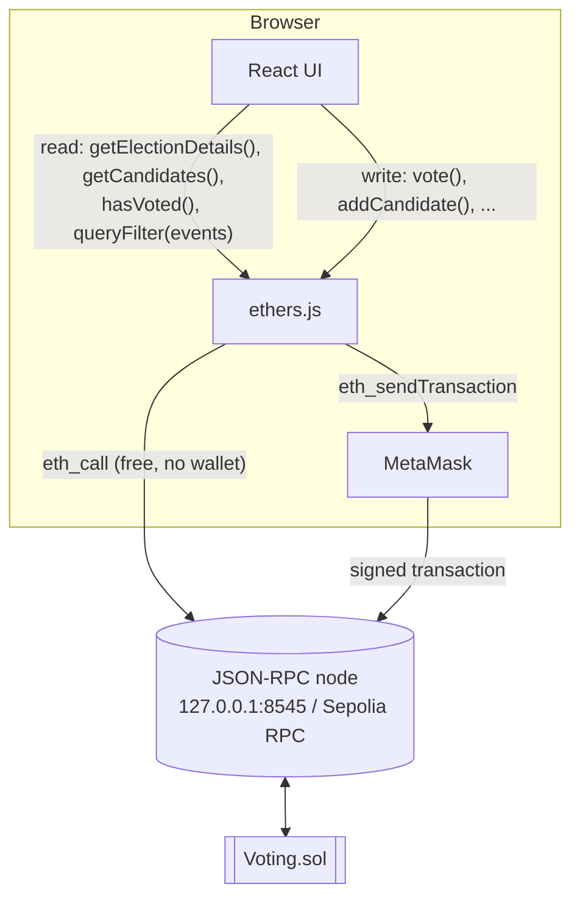
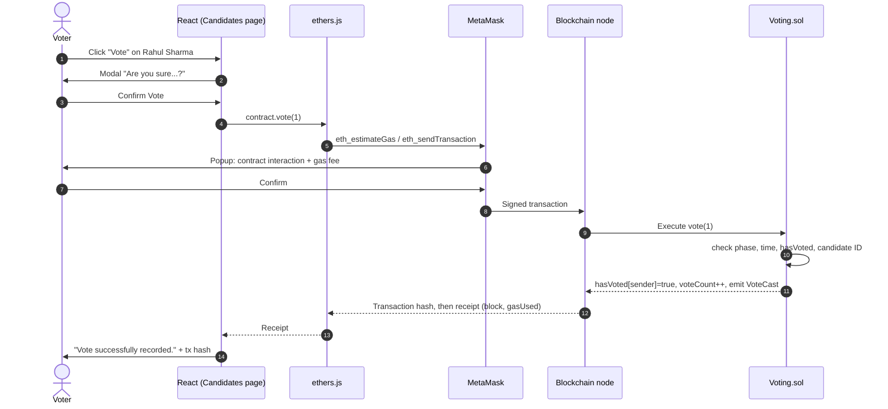
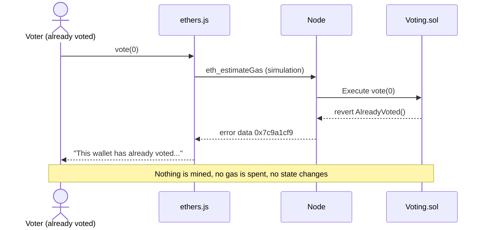

# Chapter 7: Architecture

## 7.1 Layered architecture

```
                    +----------------------+
                    |      USER            |
                    |  Voter / Admin       |
                    +----------+-----------+
                               |
                               v
                    +----------------------+
                    |   React Frontend     |   pages, components, charts
                    |      Vite            |   (no business rules)
                    +----------+-----------+
                               |
                               v
                    +----------------------+
                    |      ethers.js       |   ABI encoding, providers,
                    |  Web3 Interaction    |   error decoding
                    +----------+-----------+
                               |
                               v
                    +----------------------+
                    |      MetaMask        |   private keys, signing,
                    |   Wallet Provider    |   network switching
                    +----------+-----------+
                               |
                               v
                    +----------------------+
                    | Solidity Smart       |
                    | Contract (Voting.sol)|
                    |  Election Logic      |
                    |  Voting Logic        |
                    |  Candidate Data      |
                    |  Voter Status        |
                    +----------+-----------+
                               |
                               v
                    +----------------------+
                    | Ethereum-Compatible  |   Hardhat node (31337)
                    | Blockchain           |   or Sepolia (11155111)
                    +----------------------+
```

## 7.2 Read path vs write path



- **Read path:** `JsonRpcProvider` sends `eth_call` requests. They are free, need no wallet and do not change state, so anyone can audit the election.
- **Write path:** `BrowserProvider(window.ethereum)` gives a `Signer`. ethers.js estimates gas (this simulation already catches contract errors such as `AlreadyVoted`) and then asks MetaMask to sign and send. The UI waits for the **receipt** (`tx.wait()`) and shows the block number, gas used and fee.

## 7.3 Sequence: casting a vote



## 7.4 Sequence: rejected double vote



## 7.5 Deployment architecture

| Component | Local demo | Sepolia (optional) |
|---|---|---|
| Blockchain | `npx hardhat node` on `127.0.0.1:8545` | Public Sepolia network |
| Contract deployment | `npm run deploy:local` | `npm run deploy:sepolia` |
| Frontend | `npm run dev` on `localhost:5173` | Same, or static hosting of `frontend/dist` |
| Wallet | MetaMask with imported Hardhat accounts | MetaMask with a test account funded from a faucet |
| Explorer | none | sepolia.etherscan.io (links appear automatically) |

## 7.6 Folder structure

```
contracts/Voting.sol          smart contract
scripts/                      deploy, seed demo election, sample votes
test/Voting.test.js           automated tests
frontend/src/context/         Web3Context (wallet + contract state), ThemeContext
frontend/src/utils/           blockchain.js (ethers.js helpers), useNow.js
frontend/src/components/      reusable UI components
frontend/src/pages/           Home, Election, Candidates, Results, Admin, About
frontend/src/contracts/       Voting.json (ABI + address, generated by deploy.js)
```
